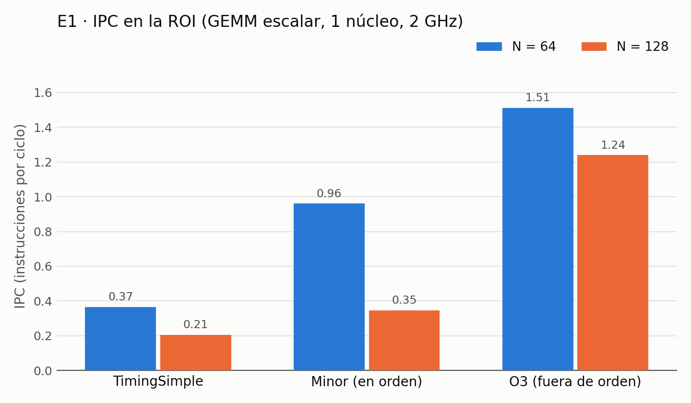
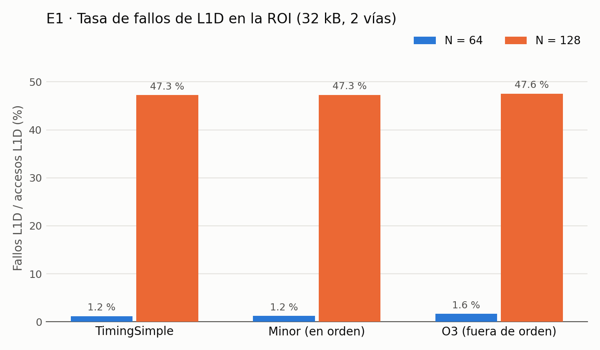

# E1 — Línea base: TimingSimple, Minor y O3

Primer experimento del proyecto. Mide la GEMM escalar en un solo núcleo con los
tres modelos de CPU de gem5 y dos tamaños de matriz. Sus resultados son la
referencia contra la que se comparan E2 (superescalar), E3 (SVE) y E4
(multiprocesador).

## Pregunta

¿Cuánto cambia el desempeño de la misma GEMM escalar al pasar de un CPU sin
pipeline (TimingSimple) a uno en orden (Minor) y a uno fuera de orden (O3), y cómo
afecta el tamaño de la matriz cuando deja de caber en la L1D?

## Matriz experimental

| Variable | Valores |
|---|---|
| CPU | `timing` (TimingSimpleCPU), `minor` (MinorCPU), `o3` (O3CPU) |
| N | 64, 128 |

3 CPU × 2 tamaños = **6 corridas**, una por carpeta en `results/e1/<cpu>_N<n>/`.

## Configuración fija

Igual en las 6 corridas (definida en `configs/run_e1.py`, comprobada en cada
`config.ini` por `verify_e1.sh`):

| Parámetro | Valor |
|---|---|
| ISA y modo | AArch64 (ARMv8-A), modo SE |
| Núcleos / hilos | 1 / 1 |
| Frecuencia | 2 GHz (`clock=500` ticks, 1 tick = 1 ps) |
| L1I | 32 kB, 2 vías, latencia 2 ciclos |
| L1D | 32 kB, 2 vías, latencia 2 ciclos |
| L2 | 256 kB, 8 vías, latencia 10 ciclos |
| Memoria | DDR3-1600 8x8, 512 MiB |
| Línea de caché | 64 B |
| gem5 | v26.0.0.0, binario `build/ARM_MESI/gem5.opt` (cachés clásicas; Ruby no se usa en E1) |
| Compilador | `aarch64-linux-gnu-gcc` 13.3.0, `-O2 -fno-tree-vectorize -march=armv8-a -static` |

## Benchmark y región de interés

`src/gemm_scalar.c` calcula `C = A × B` en `float`, orden de bucles i-j-k, sin SVE,
sin hilos y sin vectorización automática (detalle en `docs/gemm_scalar.md`).

```
init(A, B) → m5_reset_stats → gemm → m5_dump_stats → check → E1_VALIDATION: PASS|FAIL
```

Solo `gemm` queda dentro de la ROI. La validación compara cada `C[i][j]` contra una
referencia entera con igualdad exacta (A y B solo contienen enteros de 0 a 7).

## Cómo reproducir

Entorno: `docs/SETUP.md` (nativo) o `docker/README.md` (Docker). Desde la raíz del
repositorio:

```bash
./scripts/run_e1.sh ~/arqui/gem5/build/ARM_MESI/gem5.opt   # compila y corre las 6
python3 scripts/parse_e1.py                                 # → results/e1/summary.csv
python3 scripts/plot_e1.py                                  # → results/e1/*.png
./scripts/verify_e1.sh                                      # 0 = E1 verificado
```

`run_e1.sh` se detiene si alguna carpeta de salida ya existe (no sobrescribe
evidencia) o si alguna corrida no da `E1_VALIDATION: PASS`.

### Archivos

| Archivo | Qué hace |
|---|---|
| `src/gemm_scalar.c` | Benchmark con ROI y validación |
| `configs/run_e1.py` | Sistema de gem5; recibe `--cpu` y `--size` |
| `scripts/run_e1.sh` | Compila el binario AArch64 y ejecuta las 6 corridas |
| `scripts/parse_e1.py` | Lee el bloque ROI de cada `stats.txt` y escribe `summary.csv` |
| `scripts/plot_e1.py` | Genera las gráficas desde `summary.csv` |
| `scripts/verify_e1.sh` | Comprueba que la evidencia esté completa y sea coherente |

### Salida de cada corrida

| Archivo | Contenido |
|---|---|
| `stats.txt` | 2 bloques de estadísticas |
| `config.ini` | Configuración exacta que simuló gem5 |
| `run.log` | Salida de gem5 y del programa (versión de gem5, `E1_VALIDATION`) |

## Extracción de métricas

Cada `stats.txt` tiene **2 bloques**. `parse_e1.py` toma explícitamente el
**bloque 1**, que escribe `m5_dump_stats` al cerrar la ROI, y se detiene si el
archivo no tiene exactamente 2. El bloque 2 lo escribe `m5.stats.dump()` al final de
`run_e1.py` y acumula ROI + validación + salida: nunca se usa.

| Columna de `summary.csv` | Origen (bloque 1) |
|---|---|
| `cycles` | `system.cpu.numCycles` |
| `insts` | `system.cpu.commitStats0.numInsts` |
| `ipc`, `cpi` | `insts / cycles`, `cycles / insts` (se comprueba contra `system.cpu.ipc`) |
| `l1d_misses`, `l1d_accesses` | `system.cpu.dcache.demandMisses::total`, `demandAccesses::total` |
| `l2_misses`, `l2_accesses` | `system.l2cache.demandMisses::total`, `demandAccesses::total` |
| `l1d_miss_rate`, `l2_miss_rate` | fallos / accesos |
| `l1d_mpki`, `l2_mpki` | fallos por cada 1000 instrucciones |
| `roi_time_ms` | `simTicks / 10⁹` |
| `speedup_vs_timing` | `simTicks` de TimingSimple / `simTicks` del CPU, mismo N |
| `insts_model`, `insts_match_model` | `6n³ + 9n² + 8n + 20` y si coincide con `insts` |

**Por qué `commitStats0.numInsts` y no `simInsts`.** GCC deja un `nop` de
alineación que se ejecuta una vez por cada `(i, j)`, o sea n² veces. TimingSimple y
Minor lo cuentan en `simInsts`; O3 no, así que su `simInsts` es exactamente n² menor
(1 606 164 = 1 610 260 − 64²). `commitStats0.numInsts` es igual en los tres modelos y
es el mismo contador con el que gem5 calcula `ipc`.

## Resultados

| CPU | N | Ciclos | IPC | CPI | Fallos L1D | Tasa L1D | Fallos L2 | Tiempo ROI | Speedup |
|---|---|---|---|---|---|---|---|---|---|
| TimingSimple | 64 | 4 401 051 | 0,366 | 2,73 | 6 300 | 1,19 % | 258 | 2,201 ms | 1,00× |
| TimingSimple | 128 | 61 890 401 | 0,206 | 4,86 | 1 990 410 | 47,3 % | 1 026 | 30,945 ms | 1,00× |
| Minor | 64 | 1 675 124 | 0,961 | 1,04 | 6 460 | 1,20 % | 257 | 0,838 ms | 2,63× |
| Minor | 128 | 36 664 027 | 0,347 | 2,88 | 2 006 698 | 47,3 % | 1 025 | 18,332 ms | 1,69× |
| O3 | 64 | 1 064 764 | 1,512 | 0,66 | 8 723 | 1,65 % | 257 | 0,532 ms | 4,13× |
| O3 | 128 | 10 273 129 | 1,239 | 0,81 | 2 010 388 | 47,6 % | 1 025 | 5,137 ms | 6,02× |

Corridas oficiales: entorno Docker del repositorio (`docker/Dockerfile`).

Las instrucciones de la ROI son idénticas en los tres CPU (1 610 260 con N=64;
12 731 412 con N=128) y coinciden exactamente con `6n³ + 9n² + 8n + 20`: la ROI
contiene `gemm` y nada más.





## Análisis

**Orden de los CPU.** TimingSimple ejecuta una instrucción a la vez y espera cada
acceso a memoria, así que su CPI es mayor que 1 aun cuando todo acierta. Minor es un
pipeline en orden de 4 etapas: solapa instrucciones independientes, pero se detiene
ante un fallo. O3 emite fuera de orden y supera IPC = 1.

**El salto de N=64 a N=128 es de la L1D, no del CPU.** El bucle `k` recorre una
columna de B: con N=128 cada carga salta 128 × 4 B = 512 B, o sea 8 líneas. La L1D
tiene 32 kB / 64 B / 2 vías = 256 conjuntos, así que la columna solo cae en
256 / 8 = 32 conjuntos × 2 vías = 64 líneas, y necesita 128. Cada línea se expulsa
antes de reutilizarse en la siguiente `j` (fallos por conflicto): casi toda carga de
B falla (≈ n³ = 2,1 M cargas, 2,0 M fallos medidos). Como la otra mitad de las
cargas son de A y aciertan, la tasa queda cerca de 50 %. Con N=64 el salto es de 4
líneas: la columna usa 64 conjuntos × 2 vías = 128 líneas para 64 necesarias y cabe.

**O3 tolera mejor los fallos.** Los fallos de L1D aciertan en L2 (~10 ciclos). O3
sigue ejecutando instrucciones independientes mientras espera y solapa varios
fallos: su IPC solo baja de 1,51 a 1,24 y su speedup sube de 4,1× a 6,0×. Minor, en
orden, cae de 0,96 a 0,35.

**Los fallos de L2 son solo los de C.** `init()` recorre A y B antes de la ROI y
`m5_reset_stats` reinicia contadores, no cachés. A y B (32 kB con N=64, 128 kB con
N=128) ya están en la L2 de 256 kB al entrar a la ROI. Lo que falla en L2 son las
líneas de C, escritas por primera vez: 64² × 4 B / 64 B = 256 y 128² × 4 B / 64 B =
1024, más 1 o 2 de instrucciones.

**`numVecInsts` no es vectorización.** gem5 clasifica como "vector" las operaciones
escalares de punto flotante sobre registros `s`/`v` (`ldr s`, `fmadd s`, `str s`).
El desensamblado de `gemm` no tiene instrucciones NEON ni SVE (`docs/gemm_scalar.md`).

## Verificación

`scripts/verify_e1.sh` termina con código 0 solo si:

1. Existen las 6 carpetas `<cpu>_N<n>`.
2. Cada una tiene `stats.txt`, `config.ini` y `run.log`.
3. Cada `stats.txt` tiene exactamente 2 bloques.
4. Cada `run.log` dice `E1_VALIDATION: PASS` y ningún `FAIL`.
5. Cada `config.ini` tiene 1 núcleo con 1 hilo, el CPU y el N que indica la carpeta,
   2 GHz y la jerarquía L1I/L1D/L2 de la tabla de configuración.
6. `summary.csv` tiene 6 filas, sin campos vacíos, y es igual a lo que produce
   `parse_e1.py` con los `stats.txt` actuales.
7. Las instrucciones de la ROI coinciden con `6n³ + 9n² + 8n + 20` en las 6 corridas.

gem5 es determinista: con la misma versión de gem5 y el mismo binario, cualquier
integrante obtiene exactamente esta tabla.

## Reproducibilidad

Las corridas oficiales se hicieron en el contenedor Docker del repositorio. Una
corrida previa, hecha en un entorno nativo con la misma versión de gem5, dio **las mismas instrucciones en las 6 corridas** pero ciclos distintos
entre −0,05 % y +0,24 %, con más diferencia en los fallos de L1D con N=64
(5 588 contra 6 300 en TimingSimple).

La diferencia viene del binario, no del código medido: las instrucciones de la ROI
son idénticas, pero un compilador o una libc estática de ARM distintos cambian el
tamaño del ejecutable, y `malloc` coloca A, B y C en direcciones algo distintas. Eso
cambia qué líneas de A y de B chocan en los mismos conjuntos de la L1D. Con N=128 el
efecto casi desaparece, porque los fallos ya están dominados por el recorrido de
columnas de B. Hay evidencia de que no todos usaban el mismo toolchain: el
`bin/hola` que se había subido al repositorio fue compilado con GCC 15.2 (lo dice
`strings bin/hola | grep GCC:`), no con el 13.3 de `docs/SETUP.md`, y la prueba de
aceptación en Docker da `tick 46480000` en vez de `46502000`.

Conclusión: los resultados de todos los experimentos deben salir del **mismo
entorno** (el contenedor), para que las diferencias entre configuraciones no se
mezclen con diferencias de toolchain. Ninguna conclusión de E1 cambia.

## Limitaciones

- **Cachés calientes.** La ROI empieza con A y B en L2 (y parte en L1D). Representa
  una GEMM cuyos datos se acaban de producir, no una lectura en frío desde DRAM.
- **Una corrida por configuración.** No hace falta repetir: gem5 es determinista y
  no hay ruido de medición.
- **Dependencia del compilador.** El conteo exacto de instrucciones depende de GCC
  13.3 `-O2`. Con otra versión cambian los términos n² y n, y la comprobación 7
  falla a propósito.
- **Modo SE.** No hay sistema operativo ni interrupciones; las llamadas al sistema
  ocurren fuera de la ROI.
- **Parámetros por defecto de gem5** en el núcleo de Minor y O3 (anchos, ROB,
  predictor). E2 varía el ancho y el ROB de O3 explícitamente.

## Conclusiones para los siguientes experimentos

- O3 es la base para E2: es el único modelo con IPC > 1 y el que mejor oculta la
  latencia de memoria.
- Con N=128 casi la mitad de los accesos a L1D fallan por el recorrido de columnas
  de B. Cualquier mejora de cómputo (más ancho en E2, SVE en E3) va a estar limitada
  por ese patrón de acceso; conviene tenerlo presente al interpretar E2 y E3.
- Los speedups de E2–E4 deben calcularse contra la fila de O3 o de TimingSimple de
  esta tabla, con el mismo N, y decir explícitamente contra cuál.

## Responsables

| Parte | Archivos | Integrante |
|---|---|---|
| Benchmark | `src/gemm_scalar.c`, `docs/gemm_scalar.md` | _(nombre)_ |
| Configuración de gem5 | `configs/run_e1.py` | _(nombre)_ |
| Automatización | `scripts/run_e1.sh`, `docs/run_e1.md` | _(nombre)_ |
| Análisis y verificación | `scripts/parse_e1.py`, `scripts/plot_e1.py`, `scripts/verify_e1.sh`, `docs/E1.md` | Josué |
