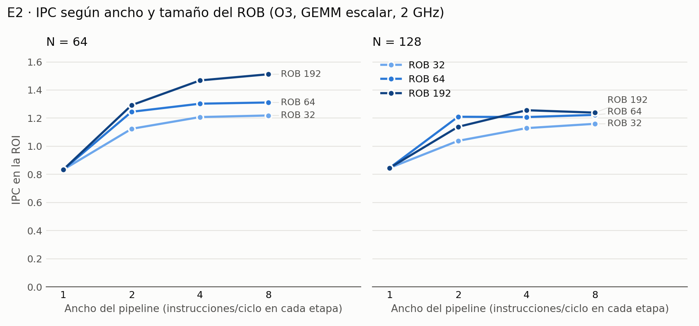
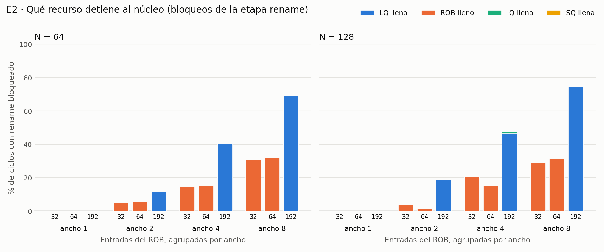

# E2 — Arquitectura superescalar: ancho del pipeline y tamaño del ROB

## Pregunta

¿Dónde se satura el IPC del núcleo O3 al aumentar el ancho del pipeline y el tamaño
del ROB, y qué recurso lo limita (ROB lleno, IQ llena, dependencias o memoria)?

## Matriz experimental

| Variable | Valores |
|---|---|
| Ancho (fetch, decode, rename, dispatch, issue, writeback, commit) | 1, 2, 4, 8 |
| Entradas del ROB | 32, 64, 192 |
| N (matrices N × N) | 64, 128 |

12 configuraciones de hardware × 2 tamaños = **24 corridas**, un solo núcleo O3.

## Configuración fija

Idéntica a E1 (`configs/run_e2.py` es una copia de `configs/run_e1.py`; solo cambia
el núcleo):

| Parámetro | Valor |
|---|---|
| Núcleo | O3 (`DerivO3CPU`), 1 núcleo, 2 GHz |
| L1I / L1D | 32 kB, 2 vías, 4 MSHR |
| L2 | 256 kB, 8 vías, 16 MSHR |
| Memoria | DDR3-1600, 512 MiB |
| IQ / LQ / SQ | 64 / 32 / 32 entradas (por defecto de gem5 v26) |
| Registros físicos | 256 por tipo (por defecto) |
| Predictor de saltos | por defecto de gem5 v26 |
| Benchmark | `bin/gemm_scalar` (mismo binario y ruta que E1) |
| `forwardComSize` | **64** (por defecto 5); ver *Metodología* |

## Cómo reproducir

Dentro del contenedor (`docker compose run --rm gem5`), desde la raíz del repo:

```bash
JOBS=3 ./scripts/run_e2.sh ~/arqui/gem5/build/ARM_MESI/gem5.opt
python3 scripts/parse_e2.py
python3 scripts/plot_e2.py
```

Detalles y columnas del CSV en [`docs/run_e2.md`](run_e2.md).

## Resultados

### IPC en la ROI

**N = 64**

| Ancho | ROB 32 | ROB 64 | ROB 192 |
|---|---|---|---|
| 1 | 0,833 | 0,833 | 0,833 |
| 2 | 1,124 | 1,245 | 1,292 |
| 4 | 1,208 | 1,303 | 1,468 |
| 8 | 1,219 | 1,311 | 1,512 |

**N = 128**

| Ancho | ROB 32 | ROB 64 | ROB 192 |
|---|---|---|---|
| 1 | 0,846 | 0,846 | 0,846 |
| 2 | 1,038 | 1,210 | 1,138 |
| 4 | 1,129 | 1,208 | 1,256 |
| 8 | 1,160 | 1,223 | 1,239 |



### Qué recurso detiene al núcleo

Porcentaje de ciclos en que la etapa rename se bloqueó porque el recurso estaba
lleno (`system.cpu.rename.<X>FullEvents / numCycles`). Formato: **ROB lleno / LQ llena**.
IQ y SQ llenas son ≤ 1 % en todas las configuraciones.

**N = 64**

| Ancho | ROB 32 | ROB 64 | ROB 192 |
|---|---|---|---|
| 1 | 0,0 / 0,0 | 0,0 / 0,0 | 0,0 / 0,0 |
| 2 | 5,2 / 0,0 | 5,8 / 0,0 | 0,0 / 11,8 |
| 4 | 14,9 / 0,0 | 15,4 / 0,0 | 0,0 / 40,5 |
| 8 | 30,5 / 0,0 | 31,7 / 0,0 | 0,0 / 69,3 |

**N = 128**

| Ancho | ROB 32 | ROB 64 | ROB 192 |
|---|---|---|---|
| 1 | 0,0 / 0,0 | 0,0 / 0,0 | 0,0 / 0,0 |
| 2 | 3,8 / 0,0 | 1,3 / 0,0 | 0,0 / 18,6 |
| 4 | 20,6 / 0,0 | 15,2 / 0,0 | 0,0 / 46,4 |
| 8 | 28,9 / 0,0 | 31,6 / 0,0 | 0,0 / 74,5 |



### Datos del núcleo relevantes para el análisis

| Dato | Valor | Fuente |
|---|---|---|
| Instrucciones del bucle interno | 6: `ldr`, `add`, `ldr` (post-incremento), `fmadd`, `cmp`, `b.ne` | desensamblado de `gemm` |
| Micro-ops del bucle interno | 7 (`ldr s2, [x0], #4` se divide en carga + actualización de `x0`) | emitidas/IPC = 1,16 con N = 64 |
| Latencia de `fmadd` (clase `FloatMultAcc`) | 5 ciclos | `config.ini`, `FUList03.opList1` |
| `fmadd` en la ROI | n³ (2 097 152 con N = 128) | `committedInstType_0::FloatMultAcc` |
| Cargas por iteración | 2 | desensamblado |
| Tasa de fallos L1D | 1,5–1,7 % (N = 64); 47,5 % (N = 128), igual en las 24 corridas | `summary.csv` |
| Saltos mal predichos | ≈ n² + n, igual en las 24 corridas (salida del bucle `k`) | `summary.csv` |

### Pruebas complementarias (no son corridas oficiales)

Para pasar de correlación a causa, se quitó un posible cuello de botella a la vez y
se midió el IPC. Se corrieron fuera del contenedor con el mismo binario; la ROI no
depende de la ruta del binario (ver `docs/E1.md`, Reproducibilidad).

**A. L1D con 16 MSHR en lugar de 4** (N = 128):

| Configuración | IPC oficial (4 MSHR) | IPC con 16 MSHR | Cambio |
|---|---|---|---|
| Ancho 2, ROB 64 | 1,210 | 1,215 | +0,4 % |
| Ancho 2, ROB 192 | 1,138 | 1,119 | −1,7 % |
| Ancho 8, ROB 192 | 1,239 | 1,325 | +6,9 % |

Ciclos con la L1D bloqueada por falta de MSHR (`dcache.blockedCycles::no_mshrs`,
4 MSHR oficiales): 0,01 % con N = 64 (ancho 8, ROB 192); 14,0 %, 17,4 % y 20,1 %
con N = 128 en las tres configuraciones de la tabla.

**B. `fmadd` con latencia 1 en lugar de 5** (ancho 8, ROB 192):

| N | IPC oficial (latencia 5) | IPC con latencia 1 | Cambio |
|---|---|---|---|
| 64 | 1,512 | 4,578 | ×3,03 |
| 128 | 1,239 | 1,442 | +16 % |

Comandos (desde la raíz del repo; borrar el archivo temporal al terminar):

```bash
# A: 16 MSHR en la L1
sed 's/^    mshrs = 4$/    mshrs = 16/' configs/run_e2.py > configs/run_e2_mshr16.py
# B: latencia 1 para FloatMultAcc
sed '/^system.cpu.numROBEntries = args.rob$/a system.cpu.instQueues[0].fuPool.FUList[3].opList[1].opLat = 1' \
    configs/run_e2.py > configs/run_e2_fma1.py

~/arqui/gem5/build/ARM_MESI/gem5.opt -d /tmp/<salida> configs/run_e2_<variante>.py \
    --width <W> --rob <R> --size <N>
```

## Análisis

**Resumen.** El IPC de GEMM escalar no lo limita el ancho del núcleo sino una
**dependencia verdadera**: cada `fmadd` necesita el resultado del anterior (el
acumulador de `C[i][j]`). El ROB y la LQ solo deciden cuánto se pueden solapar las
cadenas de dos elementos `C[i][j]` consecutivos. Con N = 128 se suma un segundo
límite, la memoria. Las pruebas complementarias A y B separan ambos efectos.

### 1. Ancho 1: limita el propio ancho

El bucle interno tiene 6 instrucciones, pero 7 micro-ops: la carga con
post-incremento `ldr s2, [x0], #4` se divide en la carga y la actualización de
`x0`. Con un pipeline de ancho 1, cada etapa procesa una micro-op por ciclo, así que
una iteración tarda al menos 7 ciclos, y el IPC (que cuenta instrucciones, no
micro-ops) no puede pasar de 6/7 = 0,857. Lo medido, 0,833 con N = 64 y 0,846 con
N = 128, está justo debajo de ese techo.

A ese ritmo, la latencia de 5 ciclos del `fmadd` nunca espera a nadie: cada `fmadd`
llega cuando el anterior ya terminó. Por eso no se acumula trabajo pendiente, ni el
ROB de 32 se llena (0 % de ciclos bloqueados en las 6 corridas de ancho 1), y el
tamaño del ROB no cambia nada. Con N = 128 el IPC es incluso un poco mayor que con
N = 64: los fallos de L1D (~10 ciclos hasta L2) quedan ocultos, porque las cargas
no dependen de la cadena y se emiten varias iteraciones antes de que su `fmadd` las
necesite; y el costo fijo de cada `C[i][j]` (salto mal predicho al salir del
bucle `k`, 9 instrucciones del bucle `j`) se reparte entre el doble de iteraciones.

### 2. El techo de la cadena de dependencias

```
ldr   s1, [x1]          ; B[k][j]
add   x1, x1, x3
ldr   s2, [x0], #4      ; A[i][k]
fmadd s0, s2, s1, s0    ; s0 += A·B  ← necesita el s0 de la iteración anterior
cmp   x0, x2
b.ne  ...
```

Desde ancho 2, el pipeline podría completar una iteración cada 3,5 ciclos (7
micro-ops / 2), pero cada `fmadd` espera los 5 ciclos de latencia del anterior
(`FloatMultAcc`, `opLat = 5`). Dentro de un mismo `C[i][j]`, la iteración `k+1` no
puede terminar antes de 5 ciclos después de la `k`, por ancho que tenga el núcleo y
por grande que sea el ROB: ejecutar fuera de orden no rompe una dependencia de
datos. Para una sola cadena:

```
IPC máximo = 6 instrucciones / 5 ciclos = 1,2
```

La prueba B lo demuestra causalmente: con la latencia del `fmadd` en 1 ciclo y todo
lo demás igual, el IPC con N = 64 pasa de 1,512 a 4,578 (×3,03).

### 3. N = 64: cómo se supera 1,2 y por qué se llenan el ROB y la LQ

Cada `C[i][j]` tiene su propio acumulador (`movi v0.2s, #0` lo reinicia), así que
las cadenas de dos `j` consecutivos son independientes. El salto que cierra el
bucle `k` depende solo de `cmp x0, x2`, que es aritmética entera de punteros, no de
la cadena: se resuelve pronto aunque esté mal predicho, y el front-end sigue con el
`j` siguiente mientras la cadena anterior todavía avanza. Mientras más instrucciones
quepan en vuelo, más iteraciones de la cadena siguiente arrancan antes de que
termine la actual.

Lo que limita cuántas caben es que las instrucciones se confirman en orden. Las
cargas, sumas y comparaciones de iteraciones futuras ya están ejecutadas, pero
esperan en el ROB detrás de los `fmadd` viejos, y cada carga mantiene ocupada su
entrada de la LQ hasta confirmarse. Como la confirmación avanza al ritmo de la
cadena (una iteración cada 5 ciclos), la ventana se llena, y el recurso que se llena
primero depende de los tamaños:

| Recurso | Entradas | Iteraciones que caben | Se llena primero con |
|---|---|---|---|
| ROB (cuenta micro-ops) | 32 / 64 / 192 | 32/7 ≈ 4,6 · 64/7 ≈ 9,1 · 192/7 ≈ 27 | ROB 32 y 64 |
| LQ (2 cargas por iteración) | 32 | 16 | ROB 192 |

Esto coincide con las tablas de bloqueos: con ROB 32 y 64 solo aparece "ROB lleno",
y con ROB 192 solo "LQ llena". **La LQ llena no es la causa del límite, es el
síntoma**: se llena porque la cadena de `fmadd` frena la confirmación, aunque casi
todas las cargas acierten en L1 (1,6 % de fallos).

Un modelo simple lo cuantifica. Si la ventana permite adelantar `k` iteraciones de
la cadena siguiente (el mínimo entre ROB/7 y 16), cada `C[i][j]` cuesta unos
`5 · (N − k)` ciclos para sus `6N + 9` instrucciones:

| N | ROB | `k` | IPC modelo | IPC medido (ancho 8) | Medido / modelo |
|---|---|---|---|---|---|
| 64 | 32 | 4,6 | 1,32 | 1,22 | 0,92 |
| 64 | 64 | 9,1 | 1,43 | 1,31 | 0,92 |
| 64 | 192 | 16 | 1,64 | 1,51 | 0,92 |
| 128 | 32 | 4,6 | 1,26 | 1,16 | 0,92 |
| 128 | 64 | 9,1 | 1,31 | 1,22 | 0,94 |
| 128 | 192 | 16 | 1,39 | 1,24 | **0,89** |

El modelo ignora el salto mal predicho de cada `C[i][j]` y los fallos de caché, por
eso sobreestima; pero lo hace en una proporción casi constante (~0,92). Es decir,
explica la tendencia: el ROB mejora el IPC en la medida en que deja solapar cadenas,
y deja de servir cuando la LQ toma el relevo.

El ancho importa solo mientras el front-end no alcanza a llenar la ventana entre
dos saltos mal predichos: con ROB 192, de ancho 2 a 4 el IPC sube de 1,29 a 1,47,
pero de 4 a 8 solo a 1,51.

### 4. N = 128: la cadena más la memoria

Con N = 128, cada cadena dura el doble (128 × 5 = 640 ciclos), así que las mismas 16
iteraciones de solapamiento pesan la mitad, y el techo del modelo baja a 1,26–1,39.
Además, con N = 128 el 47,5 % de los accesos a L1D falla: es el recorrido de
columnas de B, que provoca fallos por conflicto (explicado en `docs/E1.md`). Eso se
ve en tres indicadores:

- **Latencia de carga:** sube de ~3,5 ciclos (N = 64) a 10–14,6 ciclos.
- **MSHR ocupados:** la L1D tiene solo 4 y, en las tres configuraciones medidas,
  pasa entre el 14 y el 20 % de los ciclos rechazando accesos por no tener uno libre
  (0,01 % con N = 64).
- **Desviación del modelo:** ROB 192 es el único punto que cae a 0,89, lo que es
  coherente con que deja más cargas en vuelo de las que pueden atender 4 MSHR (la
  prueba A lo confirma).

Las pruebas complementarias ordenan las causas:

- **A (16 MSHR):** solo mejora al núcleo más agresivo (ancho 8, ROB 192: +6,9 %, y
  la razón medido/modelo sube de 0,89 a 0,96). Con ancho 2 no cambia nada. La
  memoria es un efecto **secundario**.
- **B (`fmadd` en 1 ciclo):** con N = 128 el IPC sube solo un 16 %, frente a ×3 con
  N = 64. Al quitar la cadena, el límite pasa a ser la memoria.

Con N = 128 hay dos límites apilados: la cadena de dependencias manda, y la memoria
resta lo suficiente para que el IPC se estanque cerca de 1,2 desde ancho 2. De
ancho 2 a 8 (con ROB 64) el IPC solo pasa de 1,21 a 1,22.

### 5. Respuesta a la pregunta del experimento

- **N = 64:** el IPC se satura desde ancho 4 (1,47 → 1,51 con ROB 192). El límite es
  la **dependencia** del acumulador (`fmadd` de 5 ciclos). El ROB, y después la LQ,
  solo determinan cuánto se solapan las cadenas de elementos consecutivos.
- **N = 128:** el IPC se satura ya en ancho 2 (≈ 1,2). Al mismo límite de
  dependencia se suma la **memoria**: fallos de L1D por conflicto y solo 4 MSHR.

En ningún caso el ancho es el recurso que satura, salvo con ancho 1.

## Verificación

| Comprobación | Resultado |
|---|---|
| Las 24 corridas dan `E1_VALIDATION: PASS` | ✅ |
| Instrucciones de la ROI = `6n³ + 9n² + 8n + 20` en las 24 | ✅ (`insts_match_model = yes`) |
| Ancho 8 / ROB 192 = corrida O3 de E1 (mismos parámetros) | ✅ ciclos idénticos: 1 064 764 (N = 64) y 10 273 129 (N = 128) |
| Fallos de L1D y saltos mal predichos no dependen del núcleo | ✅ constantes en las 12 configuraciones de cada N |
| Exactamente 2 bloques en cada `stats.txt`, se usa el primero | ✅ (`parse_e2.py` lo exige) |

## Metodología

- **`forwardComSize = 64`.** Con el valor por defecto (5), gem5 aborta con ancho 1 y 2
  y N = 128: `TimeBuffer out-of-bounds access! Wire index 6 is outside valid range
  [-5, +5]` en `IEW::instToCommit`. Con pocos puertos de escritura, cuando varias
  cargas que esperaban la misma línea terminan juntas, IEW reserva puertos más de 5
  ciclos hacia adelante. Es un parámetro del simulador, no del hardware; se aplica a
  las 24 configuraciones, y el control contra E1 confirma que no cambia los resultados.
- **Ancho coherente.** Las 7 etapas usan el mismo ancho; `squashWidth` queda en su
  valor por defecto (descarte en un ciclo).

## Limitaciones

- **Un solo benchmark, con un solo acumulador.** Las conclusiones dependen de la
  cadena de `fmadd`. Un GEMM con varios acumuladores por `C[i][j]` (desenrollado), o
  con otro orden de bucles, tendría mucho más paralelismo, y el ancho y el ROB
  pesarían más; la prueba B sugiere hasta ×3 con N = 64.
- **Latencias por defecto de gem5.** La latencia de 5 ciclos de `FloatMultAcc` es la
  del modelo O3 por defecto, no la de un núcleo Arm concreto, y los resultados son
  muy sensibles a ella (prueba B).
- **Recursos fijos.** IQ, LQ, SQ, registros físicos y MSHR no se variaron. Con ROB 192
  la LQ toma el relevo como recurso lleno, así que E2 no mide qué haría un ROB de 192
  con una LQ más grande.
- **Pruebas complementarias puntuales.** A y B cambian un parámetro en 2–3
  configuraciones, fuera de la matriz oficial y fuera del contenedor (la ROI no
  depende de la ruta del binario). Sirven para identificar causas, no como datos de
  rendimiento.
- **Modelo aproximado.** El modelo de solapamiento ignora los saltos mal predichos y
  la memoria; solo reproduce la tendencia (razón medido/modelo ≈ 0,92).
- **Pregunta abierta.** Con N = 128 y ancho 2, ROB 192 es más lento que ROB 64 (IPC
  1,138 contra 1,210), y no se corrige con 16 MSHR (1,119 contra 1,215). Coincide con
  más cargas rechazadas por la caché (534 282 contra 220 286) y una latencia de carga
  mayor (11,5 contra 10,6 ciclos), pero no se determinó el mecanismo. Una hipótesis
  por verificar es que, con una ventana grande, las cargas de iteraciones lejanas
  compiten por la L1D con las que alimentan la cadena más vieja, que es la que
  bloquea la confirmación.
- **Cachés calientes**, igual que en E1: la ROI empieza con A y B en L2.

## Conclusiones para E6

En la fórmula de costo, el ancho aporta W/2 por núcleo; el ROB no aparece. Con
N = 128 (el tamaño de E6), mejor ROB para cada ancho:

| Ancho | W/2 | Mejor IPC (ROB) | IPC / (W/2) |
|---|---|---|---|
| 1 | 0,5 | 0,846 (cualquiera) | 1,69 |
| 2 | 1 | 1,210 (64) | 1,21 |
| 4 | 2 | 1,256 (192) | 0,63 |
| 8 | 4 | 1,239 (192) | 0,31 |

- **Ancho 2 con ROB 64 es el punto óptimo para código escalar.** Ofrece el 96 % del
  mejor IPC medido (1,210 contra 1,256) por un cuarto del costo de ancho del núcleo
  de ancho 8. Pasar de 2 a 4 u 8 multiplica el costo por 2 o 4 a cambio de menos de
  4 % de IPC.
- **Ancho 1** tiene el mejor IPC por unidad de costo, pero un 30 % menos de IPC por
  núcleo. Solo conviene si el presupuesto se reparte entre muchos núcleos y GEMM
  escala bien en E4.
- **El ROB grande no vale la pena con N = 128:** con ancho 2, ROB 192 rinde menos que
  ROB 64. Como el ROB no está en la fórmula de costo, la recomendación es ROB 64.
- **El presupuesto ahorrado en ancho debe ir a núcleos (E4) o a longitud vectorial
  (E3):** el límite de E2 es la dependencia y la memoria, no el ancho.
- **Advertencia para E6:** con SVE la mezcla de instrucciones cambia. En la
  configuración por defecto de gem5, `SimdFloatMultAcc` tiene una latencia distinta
  de `FloatMultAcc` (`config.ini`, `FUList05`), así que la cadena de dependencias
  podría dejar de limitar y el ancho volver a importar. Antes de fijar el ancho en
  E6, conviene medir anchos 2 y 4 con el código SVE.

## Responsables

| Parte | Archivos | Integrante |
|---|---|---|
| Configuración, scripts, corridas, análisis | `configs/run_e2.py`, `scripts/run_e2.sh`, `scripts/parse_e2.py`, `scripts/plot_e2.py`, `docs/run_e2.md`, `docs/E2.md` | Andrés Guillén |

**Uso de IA generativa** (declarado según el enunciado): la redacción de los
scripts y de este documento se hizo con asistencia de IA (Claude). Todos los
resultados provienen de simulaciones propias, y cada hipótesis se puso a prueba con
una simulación (control contra E1, pruebas A y B).
